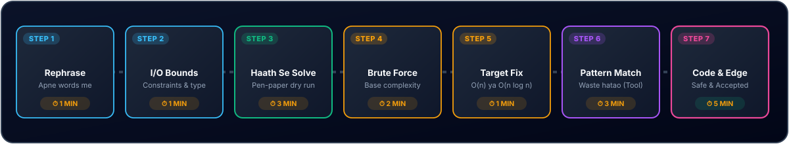
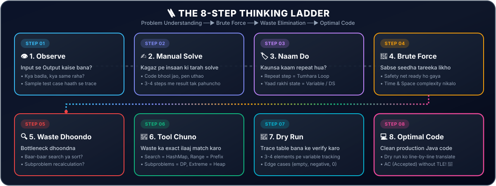
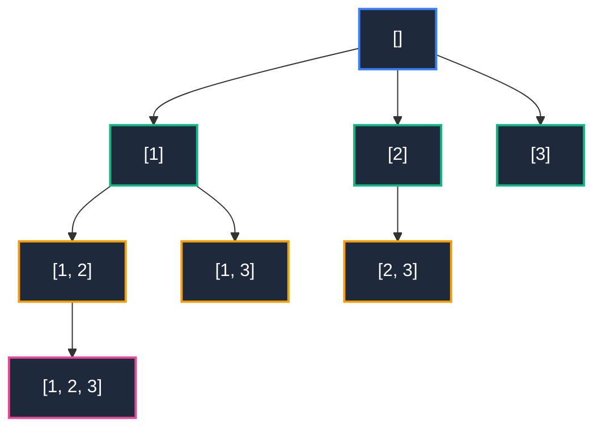
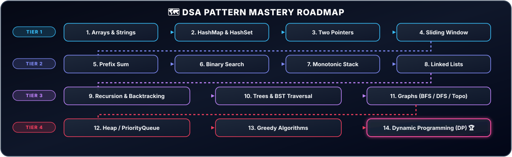

<div align="center">



</div>

<div align="center">
  
</div>

<br/>

<a id="ye-repo-kis-liye-hai"></a>
<div align="center">
  
</div>

Zyada log DSA me **code** nahi, **logic** me atakte hain. Ye guide aapko sikhati hai:

* 🔍 **Problem padhte hi kya dekhna hai** — Input, output, aur hidden constraints ka sahi interpretation.
* 🧩 **Test case se pattern kaise nikalna hai** — Haath se dry run karke underlying rule pakadna.
* ⚡ **Brute force se optimized solution tak kaise jaana hai** — Waste identify karke sahi data structure lagana.
* 🎯 **Constraints dekh ke kaunsi technique lagegi** — Input size `n` se pehle hi time complexity fix karna.
* 💻 **8 complete worked examples** — Test case se le kar line-by-line Java code tak poora step-by-step breakdown.

> [!NOTE]
> **👥 Ye Guide Kiske Liye Hai?**
> * 🎯 **DSA Beginners:** Jo code ratne ke bajay logic building aur step-by-step thinking sikhna chahte hain.
> * 💼 **Interview Aspirants:** Jo tech coding interviews me unseen problems pe structured approach lagana chahte hain.
> * 🎓 **College Students:** Jo campus placements aur semester exams ke liye strong conceptual foundation chahte hain.
> * ⚡ **Problem Solvers:** Jo brute force se optimal complexity tak jana systematically samajhna chahte hain.

<br/>

<a id="table-of-contents"></a>
## 📑 Table of Contents

<details open>
<summary><b>Click to expand / collapse full Table of Contents</b></summary>

<br/>

| # | Section | Key Topic / Takeaway |
| :---: | :--- | :--- |
| **01** | [🌟 1. Golden Rules](#1-golden-rules) | 5 non-negotiable mental principles |
| **02** | [🪜 2. Seven Step Framework](#2-seven-step-framework) | Har problem solve karne ka 7-step blueprint |
| **03** | [🔎 3. Problem Ko Samjho](#3-problem-ko-samjho) | 5 sawal + Output type se hint chart |
| **04** | [🧪 4. Test Case Se Logic Kaise Nikale](#4-test-case-se-logic-kaise-nikale) | Human method + Kadane's algorithm derivation |
| **05** | [🔨 5. Brute Force Hamesha Pehle](#5-brute-force-hamesha-pehle) | Safety net build karna & waste dhoondna |
| **06** | [⏱️ 6. Constraints Se Complexity Pehchano](#6-constraints-se-complexity-pehchano) | `n` ka size vs Allowed time complexity |
| **07** | [🔑 7. Keyword Se Technique Pehchano](#7-keyword-se-technique-pehchano) | 18 direct problem keywords to patterns cheat-table |
| **08** | [🧱 8. Core Patterns With Java Templates](#8-core-patterns-with-java-templates) | Two Pointers, Sliding Window, DP, Graphs & more |
| **09** | [🪜 9. Thinking Ladder](#9-thinking-ladder) | 8-step mental ladder + Waste to Tool matching chart |
| **10** | [💡 10. Worked Examples Step by Step](#10-worked-examples-step-by-step) | 8 deep-dive problems completely solved |
| **11** | [🔬 11. Test Case Padhne Ki 6 Techniques](#11-test-case-padhne-ki-6-techniques) | 6 angles to read test cases + 7 fill-in blanks |
| **12** | [✅ 12. Edge Cases Checklist](#12-edge-cases-checklist) | Code likhne se pehle 9 critical checks |
| **13** | [🆘 13. Jab Atak Jao To Kya Karo](#13-jab-atak-jao-to-kya-karo) | Debugging mental blocks in real time |
| **14** | [📅 14. Practice Plan](#14-practice-plan) | Pattern-based structured roadmap |
| **15** | [⚡ 15. One Page Quick Revision](#15-one-page-quick-revision) | 10 sawal + 5 fundamental mantras |
| **16** | [🤝 16. Contributing](#16-contributing) | How to help improve this open-source playbook |

</details>

<br/>

<a id="1-golden-rules"></a>
<div align="center">
  
</div>

> [!IMPORTANT]
> **Har coding session shuru karne se pehle ye 5 non-negotiable rules dimag me baitha lo:**
> 
> 1. 🚫 **RULE 01 • Code Se Pehle Logic:** Keyboard tab chhuo jab paper pe pata ho ki exact kya likhna hai.
> 2. 🪜 **RULE 02 • Seedha Optimal Nahi Aata:** Pehle working brute force banao, phir bottleneck dekh ke improve karo.
> 3. 🧪 **RULE 03 • Test Case Sabse Bada Hint Hai:** Input se output kaise bana, haath se pen-paper pe trace karke dekho.
> 4. ⏱️ **RULE 04 • Constraints Batate Hain Technique:** Problem ka `n` kitna bada hai, wahi bata deta hai kaunsa algorithm chalega.
> 5. 🔁 **RULE 05 • Problem Naya Nahi Hota, Pattern Purana Hota Hai:** DSA me ginke sirf 15–20 fundamental patterns hote hain.

<br/>

[⬆ Back to Top](#table-of-contents)

<br/>

<a id="2-seven-step-framework"></a>
<div align="center">
  
</div>

Har problem pe ye structured sequence follow karo:

<div align="center">
  
</div>

<br/>

| Step | Kya karna hai | Suggested Time | Key Focus |
| :---: | :--- | :---: | :--- |
| **1** | Problem dobara apne words me bolo | `1 min` | Misunderstandings clear karo |
| **2** | Input, Output, Constraints likho | `1 min` | Bounds aur data types check karo |
| **3** | Test case ko haath se solve karo | `3 min` | Mental steps observe karo |
| **4** | Brute force socho aur complexity nikalo | `2 min` | Base working solution |
| **5** | Constraints dekh ke target complexity decide karo | `1 min` | `O(n)`, `O(n log n)` target fix |
| **6** | Pattern pehchano, brute force ko optimize karo | `3 min` | Waste hatao using right tool |
| **7** | Edge cases check karo, phir code likho | `5 min` | Off-by-one, empty input safety |

<br/>

[⬆ Back to Top](#table-of-contents)

<br/>

<a id="3-problem-ko-samjho"></a>
<div align="center">
  
</div>

Problem padhne ke turant baad apne aap se ye **5 basic questions** poochho:

* 📥 **Input kya hai?** (Array, string, number, tree, graph, ya matrix?)
* 📤 **Output kya chahiye?** (Single number, boolean `true/false`, index, array, count, min/max value?)
* 🔢 **Kya input sorted hai?** Agar sorted ho, to `Binary Search` ya `Two Pointers` lagne ke 90% chances hote hain.
* ⚠️ **Duplicates, negatives, empty input** allowed hain?
* 📏 **Constraints kya hain?** `n` kitna bada hai? (Limits of `10^5`, `10^9`, etc.)

<br/>

### 💡 Output Type Se Hint

Output ka structure hi aksar data structure reveal kar deta hai:

| Output Type | Aksar Kaunsi Technique Lagti Hai |
| :--- | :--- |
| 🔘 **Sirf `true` / `false`** | Hashing, Two Pointers, Dynamic Programming, Graph Traversal |
| 🔢 **Count of ways** | DP (Combinations), Combinatorics, Backtracking |
| 🏆 **Min / Max value** | Dynamic Programming, Greedy, Binary Search on Answer |
| 🌳 **Saare Subsets / Permutations / Combinations** | Backtracking, Recursion (Decision Tree) |
| 📍 **Index ya Specific Pair** | HashMap, Two Pointers, Binary Search |
| 🧭 **Shortest Path / Min Steps** | BFS (Unweighted), Dijkstra (Weighted) |
| 🔝 **Top K / K-th Element** | Heap (PriorityQueue), Quickselect, Sorting |

<br/>

[⬆ Back to Top](#table-of-contents)

<br/>

<a id="4-test-case-se-logic-kaise-nikale"></a>
<div align="center">
  
</div>

> [!WARNING]
> Ye wo critical step hai jo 90% log jaldbazi me skip karte hain, aur isi wajah se unka logic kabhi nahi banta.

<br/>

### 🧠 Method: Insaan Ki Tarah Solve Karo

Socho tumhe ye kaam **haath se, bina computer aur bina code ke** karna hai:

1. 📝 **Sample input** kagaz pe likho.
2. 👣 **Output tak kaise pahunche**, step by step likho — dimag me nahi, paper pe.
3. 🔁 Poochho: *"Maine kaunsa kaam baar baar kiya?"* &rarr; **Wahi tumhara loop hai.**
4. 🧠 Poochho: *"Pichhle step ka kya yaad rakha?"* &rarr; **Wahi tumhara variable / data structure hai.**
5. 🛑 Poochho: *"Kab ruka?"* &rarr; **Wahi tumhari stopping / boundary condition hai.**

<br/>

### 📌 Example: Maximum Subarray Sum

* **Input:** `[-2, 1, -3, 4, -1, 2, 1, -5, 4]`
* **Expected Output:** `6`

<br/>

**✍️ Haath se step-by-step karo:**

* Pehla element `-2` &rarr; Running sum = `-2`.
* Agla element `1` &rarr; Pichhla sum negative hai (`-2`), to usko aage saath leke chalna nuksan hai. **Naya sum `1` se fresh start karo.**
* `-3` aaya &rarr; Sum = `1 + (-3) = -2`. Phir se negative ho gaya, **restart** ready rakho.
* `4` aaya &rarr; Fresh start `sum = 4`. Aage `-1`, `2`, `1` jodte gaye &rarr; Running sums: `3`, `5`, `6`.
* **Max dekha = 6.**

> [!NOTE]
> **💡 Pattern Nikla:** *"Agar pichhla running sum negative ho jaye to use chhod do, warna aage jodte jao."*  
> Yahi **Kadane's Algorithm** hai! Tumne bina kisi ratte ke khud ise derive kar liya!

<br/>

```java
public int maxSubArray(int[] nums) {
    int cur = nums[0], best = nums[0];
    
    for (int i = 1; i < nums.length; i++) {
        cur = Math.max(nums[i], cur + nums[i]);   // restart ya jodte jao
        best = Math.max(best, cur);
    }
    
    return best;
}
```

<br/>

### 🪜 Chhote Input Se Bade Ki Taraf Jao

* Pehle **bahut chhota input** (2–3 elements) pe pen-paper solve karo.
* Phir thoda **medium input** pe test karo.
* Dekho tumhara banaya hua tareeka kahan fail ho raha hai. Wahi failure point tumhe asli edge-case logic sikhata hai.

<br/>

### 🧪 Apne Khud Ke Test Cases Banao

Sirf question ke diye test case pe rely mat karo. Khud banao:
* Empty ya single element (`[]`, `[5]`)
* Sab identical elements (`[2, 2, 2, 2]`)
* Sorted ya reverse sorted (`[1, 2, 3]`, `[3, 2, 1]`)
* All negative numbers (`[-5, -2, -9]`)
* Max possible constraint limit

<br/>

[⬆ Back to Top](#table-of-contents)

<br/>

<a id="5-brute-force-hamesha-pehle"></a>
<div align="center">
  
</div>

Brute force ek **safety net** hai. Ye prove karta hai ki tumhe problem 100% samajh aa chuki hai.

<br/>

**🛠️ Brute force kaise sochein:**

* *"Saare possibilities try karo"* &rarr; Nested loops ya recursion.
* *"Har pair check karo"* &rarr; `O(n²)`.
* *"Har subarray check karo"* &rarr; `O(n²)` ya `O(n³)`.
* *"Har subset check karo"* &rarr; `O(2ⁿ)`.

<br/>

Brute force likhne ya sochne ke baad **ek hi sawal poochho:**

> [!IMPORTANT]
> **"Is brute force solution me kaunsa kaam baar baar ho raha hai ya bina wajah repeat ho raha hai?"**  
> Wahi tumhara **bottleneck** hai, aur har optimal solution usi waste ko hatane se nikalta hai!

<br/>

[⬆ Back to Top](#table-of-contents)

<br/>

<a id="6-constraints-se-complexity-pehchano"></a>
<div align="center">
  
</div>

Ye table memorise kar lo. Problem me `n` dekhte hi pata chal jata hai ki kitni fast solution chahiye:

| `n` ka Size | Allowed Time Complexity | Speed Category | Kaunsi Techniques Lag Sakti Hain |
| :--- | :---: | :---: | :--- |
| **`n ≤ 10`** | `O(n!)` | 🔴 Extremely Slow (Factorial) | Permutations, Backtracking |
| **`n ≤ 20`** | `O(2ⁿ)` | 🔴 Exponential | Subsets generation, Bitmask DP, Backtracking |
| **`n ≤ 500`** | `O(n³)` | 🟠 Cubic | 3 nested loops, Floyd-Warshall, 3D Dynamic Programming |
| **`n ≤ 5,000`** | `O(n²)` | 🟡 Quadratic | 2 nested loops, 2D Dynamic Programming |
| **`n ≤ 10⁵`** | `O(n log n)` | 🟢 Linearithmic (Optimal) | Sorting, Heap, Binary Search, Divide & Conquer |
| **`n ≤ 10⁶`** | `O(n)` | 🟢 Linear (Fast) | Hashing, Two Pointers, Sliding Window, Prefix Sum |
| **`n ≥ 10⁹`** | `O(log n)` ya `O(1)` | ⚡ Lightning Fast | Binary Search, Mathematical Formula, Bit Manipulation |

<br/>

> [!TIP]
> **⚡ Thumb Rule:** Competitive programming aur online judges (LeetCode) pe **1 second me lagbhag 10⁸ operations** allow hote hain.

<br/>

> [!WARNING]
> **Example:** Agar `n = 10⁵` hai aur tumhara brute force `O(n²)` hai, to total operations `(10⁵)² = 10¹⁰` honge.  
> Ye guaranteed **TLE (Time Limit Exceeded)** dega! Iska matlab solution `O(n log n)` ya `O(n)` hi hona chahiye. Ab sirf wahi techniques dimag me lao!

<br/>

[⬆ Back to Top](#table-of-contents)

<br/>

<a id="7-keyword-se-technique-pehchano"></a>
<div align="center">
  
</div>

Problem statement ke words me hi solution ka hint chhupa hota hai:

| Problem me ye Keyword / Requirement Dikhe | Ye Technique Dimag Me Lao |
| :--- | :--- |
| 🔀 **Sorted array**, pair ya triplet dhoondna | Two Pointers, Binary Search |
| 🪟 **Subarray / substring**, contiguous, max/min length | Sliding Window |
| ➕ **Subarray sum**, range sum query multiple times | Prefix Sum |
| 🔍 **Duplicate**, frequency count, "pehle dekha hai?", pair sum | HashMap / HashSet |
| 🎯 **Sorted + search**, "minimum X jo condition satisfy kare" | Binary Search (on answer pattern) |
| 🧱 **Brackets matching**, next greater element, undo, nested | Stack, Monotonic Stack |
| 🏔️ **Top K largest / smallest**, running median, merge K lists | Heap / PriorityQueue |
| 🔗 **Linked list me cycle**, middle node dhoondna | Fast & Slow Pointers (Floyd's Cycle) |
| 🌲 **Tree traversal**, height, max path sum | DFS, BFS, Tree Recursion |
| 🌐 **Shortest path**, level-order traversal, min steps | BFS |
| 🏝️ **Connected components**, islands, clusters | DFS, BFS, Disjoint Set Union (Union-Find) |
| 📋 **Dependencies**, prerequisite ordering (course schedule) | Topological Sort (Kahn's / DFS) |
| 🔠 **Saare subsets, permutations, combinations** | Backtracking |
| 💰 **Har step pe locally best choice**, intervals, scheduling | Greedy (aksar Sorting ke baad) |
| 📊 **Count ways, min cost, max profit**, overlapping subproblems | Dynamic Programming (DP) |
| 📖 **Prefix match**, dictionary words search, autocomplete | Trie (Prefix Tree) |
| ⚙️ **Bit operations**, single non-duplicate number, power of 2 | Bit Manipulation |
| 📏 **Intervals merge ya overlap check** | Sort by start time, phir merge loop |

<br/>

[⬆ Back to Top](#table-of-contents)

<br/>

<a id="8-core-patterns-with-java-templates"></a>
<div align="center">
  
</div>

<br/>

> 💡 **Jump Directly to Any Pattern:**  
> [↔️ 8.1 Two Pointers](#81-two-pointers) &nbsp;•&nbsp; 
> [🪟 8.2 Sliding Window](#82-sliding-window) &nbsp;•&nbsp; 
> [➕ 8.3 Prefix Sum](#83-prefix-sum) &nbsp;•&nbsp; 
> [🗂️ 8.4 HashMap](#84-hashmap) &nbsp;•&nbsp; 
> [🎯 8.5 Binary Search](#85-binary-search) &nbsp;•&nbsp; 
> [🥞 8.6 Stack](#86-stack) &nbsp;•&nbsp; 
> [🔄 8.7 Backtracking](#87-recursion-and-backtracking) &nbsp;•&nbsp; 
> [📊 8.8 Dynamic Programming](#88-dynamic-programming-dp) &nbsp;•&nbsp; 
> [🌐 8.9 BFS & DFS](#89-bfs-and-dfs) &nbsp;•&nbsp; 
> [🦅 8.10 Greedy](#810-greedy) &nbsp;•&nbsp; 
> [🏔️ 8.11 Heap](#811-heap-priorityqueue)

<br/>

### 8.1 ↔️ Two Pointers

* **💡 Core Idea:** Do pointers (`l`, `r`) ko opposite ends ya same direction se move karo, nested loops se bacho.
* **🎯 Kab Lagayein:** Sorted array, pair sum, palindrome check, in-place array reverse.

```java
int l = 0, r = arr.length - 1;
while (l < r) {
    int sum = arr[l] + arr[r];
    if (sum == target) { 
        // target pair mil gaya
        break; 
    } else if (sum < target) {
        l++;
    } else {
        r--;
    }
}
```

<br/>

### 8.2 🪟 Sliding Window

* **💡 Core Idea:** Ek dynamic window `[l, r]` maintain karo. Right pointer badhaye jao, jab condition violate ho to Left pointer se shrink karo.
* **🎯 Kab Lagayein:** "Longest ya shortest contiguous subarray/substring jisme koi specific condition satisfy ho."

```java
int l = 0, best = 0;
for (int r = 0; r < n; r++) {
    // 1. arr[r] ko current window me include karo
    
    // 2. jab tak window invalid ho, shrink from left
    while (/* window invalid condition */ false) {
        // arr[l] ko window se hatao
        l++;
    }
    
    // 3. valid window size record karo
    best = Math.max(best, r - l + 1);
}
```

<br/>

### 8.3 ➕ Prefix Sum

* **💡 Core Idea:** Array ka running cumulative sum pehle hi store kar lo, jisse kisi bhi range `[l, r]` ka sum `O(1)` me mil sake.

```java
int[] prefix = new int[n + 1];
for (int i = 0; i < n; i++) {
    prefix[i + 1] = prefix[i] + arr[i];
}

// Range sum query for subarray arr[l...r]:
// sum(l..r) = prefix[r + 1] - prefix[l]
```

> [!TIP]
> **Pro Trick:** *"Subarray sum = K"* dhoondne ke liye Prefix Sum ko **HashMap** ke saath pair kiya jata hai.

<br/>

### 8.4 🗂️ HashMap

* **💡 Core Idea:** Expensive `O(n)` linear search ko `O(1)` lookup me badal do. "Pehle kaunsa element dekha tha" yaad rakho.

```java
Map<Integer, Integer> map = new HashMap<>();
for (int i = 0; i < arr.length; i++) {
    int complement = target - arr[i];
    if (map.containsKey(complement)) { 
        // complement pair mil gaya: indices i and map.get(complement)
    }
    map.put(arr[i], i);
}
```

<br/>

### 8.5 🎯 Binary Search

* **💡 Core Idea:** Har step pe search space ko exactly aadha (`1/2`) kar do.
* **🎯 Kab Lagayein:** Sorted data me target dhoondna, ya answer monotonic ho jisme `check(x)` yes/no return kare.

```java
int lo = 0, hi = n - 1;
while (lo <= hi) {
    int mid = lo + (hi - lo) / 2;      // integer overflow protection
    
    if (arr[mid] == target) return mid;
    else if (arr[mid] < target) lo = mid + 1;
    else hi = mid - 1;
}
return -1;
```

> [!NOTE]
> **Binary Search on Answer:** *"Minimum X jo condition satisfy kare"* &rarr; X ki range `[minPossible, maxPossible]` pe binary search lagao aur ek separate helper function `boolean check(X)` likho.

<br/>

### 8.6 🥞 Stack

* **💡 Core Idea:** Last-In-First-Out (LIFO). Jo element sabse recent aaya hai, uski state sabse pehle resolve karni ho.
* **🎯 Kab Lagayein:** Valid Parentheses matching, Next Greater Element, Daily Temperatures.

```java
Deque<Character> stack = new ArrayDeque<>();
for (char ch : s.toCharArray()) {
    if (ch == '(' || ch == '{' || ch == '[') {
        stack.push(ch);
    } else {
        if (stack.isEmpty()) return false;
        char top = stack.pop();
        if ((ch == ')' && top != '(') || 
            (ch == '}' && top != '{') || 
            (ch == ']' && top != '[')) {
            return false;
        }
    }
}
return stack.isEmpty();
```

<br/>

### 8.7 🔄 Recursion and Backtracking

* **💡 Core Idea:** Choice lo, aage explore karo, agar galat rasta nikla to wapas aakar step undo karo.  
  **3 Mantras: Choose &rarr; Explore &rarr; Undo.**

```java
void solve(List<Integer> path) {
    if (/* base case reached */ false) { 
        result.add(new ArrayList<>(path)); 
        return; 
    }
    
    for (int choice : choices) {
        path.add(choice);              // 1. Choose
        solve(path);                   // 2. Explore
        path.remove(path.size() - 1);  // 3. Undo (Backtrack)
    }
}
```

<br/>

### 8.8 📊 Dynamic Programming (DP)

* **💡 Core Idea:** Bade problem ko chhote overlapping subproblems me todo, aur calculated results ko cache (memoize/table) kar lo taaki recalculation zero ho.
* **🎯 DP Kaise Pehchano:** *"Count number of ways"*, *"Min / Max value"*, *"Is it possible?"* + Har element pe choice (Include karo ya Exclude karo).

<br/>

**DP ke 4 Core Steps:**
1. **State:** `dp[i]` ka exact matlab kya hai? Pehle plain words me likho.
2. **Transition:** `dp[i]` ko pichhle calculated subproblems se kaise compute karein?
3. **Base Case:** Sabse chhota/trivial answer kya hai (`dp[0]`)?
4. **Final Answer:** Answer table me kahan milega (`dp[n]` ya `max(dp)`)?

> [!TIP]
> **Shortcut Flow:** Pehle Brute Force Recursion &rarr; Phir Memoization (Top-down) &rarr; Finally Tabulation (Bottom-up).

<br/>

### 8.9 🌐 BFS and DFS

* **BFS (Breadth-First Search):** `Queue` use karta hai. Level-by-level traversal. Unweighted graphs me shortest path guarantee karta hai.
* **DFS (Depth-First Search):** `Recursion` ya `Stack` use karta hai. Ek raaste pe ant tak jao, phir backtrack karo. Connected components, cycle detection, aur tree traversals ke liye best hai.
* **Rule:** Graphs aur 2D grids me hamesha **`visited` state track karo** infinite loops se bachne ke liye.

```java
Queue<int[]> q = new ArrayDeque<>();
q.add(new int[]{startR, startC});
boolean[][] visited = new boolean[R][C];
visited[startR][startC] = true;

while (!q.isEmpty()) {
    int[] cur = q.poll();
    // 4 cardinal directions (up, down, left, right) explore karo:
    // agar cell valid aur unvisited hai to visited mark karke queue me push karo
}
```

<br/>

### 8.10 🦅 Greedy

* **💡 Core Idea:** Har individual step pe locally best/safest choice lo, bina aage ka soche. Ye tab kaam karta hai jab locally optimal choice hi global optimal solution banaye.
* **🎯 Verification Check:** Aksar data ko sort karne ke baad lagta hai. Apne logic pe counter-example dhoondo; agar koi counter-example na mile, to greedy safe hai.

<br/>

### 8.11 🏔️ Heap (PriorityQueue)

* **💡 Core Idea:** Sabse chhota (Min-Heap) ya sabse bada (Max-Heap) element constant time `O(1)` me dekho aur `O(log n)` me extract karo.
* **🎯 Pro Trick:** *"Top K largest elements"* ke liye hamesha **Min-Heap of size K** maintain karo!

```java
PriorityQueue<Integer> pq = new PriorityQueue<>();   // Java default is Min-Heap
for (int x : arr) {
    pq.add(x);
    if (pq.size() > k) {
        pq.poll(); // jo sabse chhota hai wo bahar nikal jayega
    }
}
// pq.peek() ab exact k-th largest element return karega!
```

<br/>

[⬆ Back to Top](#table-of-contents)

<br/>

<a id="9-thinking-ladder"></a>
<div align="center">
  
</div>

Har DSA problem pe ye **8 seedhiyan (steps)** sequentially chadhna hai. Seedha code pe jump mat karo — is framework se kisi bhi tough problem ka logic 10 minute me unlock ho jata hai:

<br/>

<div align="center">
  
</div>

<br/>

### 🗺️ The 4 Phases of Thinking Ladder

<br/>

#### 🔵 Phase 1: Problem Exploration (Paper Work)
* **Step 1: 👁️ Observe (Gaur Se Dekho)**
  * **Sawal:** Input se output kaise bana? Kaunsi values change hui aur kaunsi same rahi?
  * **Action:** Diye gaye test case ko dhyan se dekho. Numbers shift hue, sort hue, ya filter hue?
  * **Trap:** *Bina input-output ka relation samjhe seedha formula dhoondna.*

* **Step 2: ✍️ Manual Solve (Insaan Ki Tarah Karo)**
  * **Sawal:** Agar mujhe pen-paper pe bina kisi coding ke ye solve karna hota, to main kya karta?
  * **Action:** Chhote sample input (3-4 elements) pe apne haath se answer calculate karo.
  * **Trap:** *Pehle hi computer loops ke baare me sochna.*

<br/>

#### 🟡 Phase 2: Baseline & Formulation
* **Step 3: 🏷️ Naam Do (Loop & Variables Pehchano)**
  * **Sawal:** Maine manually solve karte waqt kaunsa kaam baar-baar kiya, aur kya yaad rakha?
  * **Action:** Jo kaam baar-baar repeat hua &rarr; **Wahi Loop hai**. Agle step ke liye jo yaad rakha &rarr; **Wahi Variable / Data Structure hai**.
  * **Trap:** *Seedha complex variables declare kar dena bina purpose jaane.*

* **Step 4: 🔨 Brute Force (Safety Net Banao)**
  * **Sawal:** Sabse basic, bina kisi smart trick ka tareeka kya hai? Iski complexity kya hai?
  * **Action:** Nested loops ya simple recursion socho jo 100% correct answer de (bhale slow ho).
  * **Trap:** *Brute force ko bekaar samajh ke skip karna.* (Ye tumhara baseline reference hai!)

<br/>

#### 🔴 Phase 3: The Optimization Breakthrough
* **Step 5: 🔍 Waste Dhoondo (Find the Bottleneck)**
  * **Sawal:** Brute force me kaunsa computation repeat ya bekaar ho raha hai?
  * **Action:** Dekho kahan loop baar-baar poora array scan kar raha hai, ya same subproblem recalculate ho raha hai.
  * **Trap:** *Code optimize karne ki koshish karna jabki algorithm hi inefficient ho.*

* **Step 6: 🧰 Tool Chuno (Pick the Weapon)**
  * **Sawal:** Is specific waste ko hatane wala exact data structure / algorithm kaunsa hai?
  * **Action:** Niche diye gaye **Prescription Matrix** se match karo: Search slow hai to HashMap, range slow hai to Prefix Sum, repeated subproblems hain to DP!
  * **Trap:** *Random data structures guess karna.*

<br/>

#### 🟢 Phase 4: Execution & Verification
* **Step 7: 🧪 Dry Run (Trace Table Verification)**
  * **Sawal:** Kya ye tool mere test case pe flawlessly step-by-step kaam kar raha hai?
  * **Action:** Ek chhota trace table banao (variables ki values har iteration me trace karo). Extreme edge cases check karo.
  * **Trap:** *Bina dry run kiye seedha IDE me code likhna.*

* **Step 8: 💻 Optimal Code (Clean Java Implementation)**
  * **Sawal:** Dry run ke table ko clean code me kaise convert karein?
  * **Action:** verified trace table ke logic ko line-by-line syntax me translate karo. Boundary checks pehle likho.
  * **Result:** **100% Accepted (AC) without TLE on First Submission! 🎯**

<br/>

---

<br/>

### 🧰 Waste Ko Tool Se Match Karo (The Prescription Matrix)

> [!TIP]
> **Ye is poori playbook ka sabse powerful shortcut hai.** Brute force ka bottleneck pehchano aur direct right tool uthao:

<br/>

| # | 🚨 Brute Force Me Jo Waste / Bottleneck Hai | 🧰 Uska Exact Ilaaj (Tool) | ⚡ Complexity Drop | 💡 Live Example Problem |
| :---: | :--- | :--- | :---: | :--- |
| **1** | Baar-baar linear search: *"kya ye element pehle dekha tha?"* | **`HashMap` / `HashSet`** | `O(n) &rarr; O(1)` | Two Sum, Subarray Sum Equals K |
| **2** | Har query pe range ka sum ya product baar-baar calculate karna | **Prefix Sum / Suffix Array** | `O(n) &rarr; O(1)` | Range Sum Query, Product Except Self |
| **3** | Har pair check karna, jabki array sorted hai ya sort ho sakta hai | **Sort + Two Pointers** | `O(n²) &rarr; O(n)` | 3Sum, Container With Most Water |
| **4** | Subarray/window ka common part har step pe recalculate karna | **Sliding Window** | `O(n²) &rarr; O(n)` | Longest Substring Without Repeating |
| **5** | Monotonic sequence me ek-ek step aage badh ke dhoondna | **Binary Search (on Answer)** | `O(n) &rarr; O(log n)` | Koko Bananas, Search Rotated Array |
| **6** | Same subproblem recursion tree me baar-baar solve hona | **Dynamic Programming (DP)** | `O(2ⁿ) &rarr; O(n)` | Coin Change, Climbing Stairs |
| **7** | Pichhle elements ka order yaad rakhna ya matching pairs (LIFO) | **Monotonic Stack** | `O(n²) &rarr; O(n)` | Daily Temperatures, Valid Parentheses |
| **8** | Har step pe continuous dynamic min ya max element dhoondna | **Heap / PriorityQueue** | `O(n) &rarr; O(log n)` | Top K Frequent, Merge K Sorted Lists |
| **9** | Random unordered intervals me overlap check karna | **Sort by Start Time** | `O(n²) &rarr; O(n log n)` | Merge Intervals, Meeting Rooms |

<br/>

[⬆ Back to Top](#table-of-contents)

<br/>

<a id="10-worked-examples-step-by-step"></a>
<div align="center">
  
</div>

Har example me wahi **Thinking Ladder** framework lagaya gaya hai: test case observation se shuru, clean Java code pe khatam.

<br/>

### 📋 Quick Index of Worked Examples

| # | Problem | Core Pattern | Target Time | Target Space | Direct Jump |
| :---: | :--- | :--- | :---: | :---: | :---: |
| **10.1** | [Product of Array Except Self](#101-product-of-array-except-self) | `Prefix & Suffix Product` | `O(n)` | `O(1)` | [View Solution ➔](#101-product-of-array-except-self) |
| **10.2** | [Subarray Sum Equals K](#102-subarray-sum-equals-k) | `Prefix Sum + HashMap` | `O(n)` | `O(n)` | [View Solution ➔](#102-subarray-sum-equals-k) |
| **10.3** | [Container With Most Water](#103-container-with-most-water) | `Two Pointers (Greedy Choice)` | `O(n)` | `O(1)` | [View Solution ➔](#103-container-with-most-water) |
| **10.4** | [Merge Intervals](#104-merge-intervals) | `Sorting by Start + Greedy` | `O(n log n)` | `O(n)` | [View Solution ➔](#104-merge-intervals) |
| **10.5** | [Koko Eating Bananas](#105-koko-eating-bananas) | `Binary Search on Answer` | `O(n log(max))` | `O(1)` | [View Solution ➔](#105-koko-eating-bananas) |
| **10.6** | [Coin Change](#106-coin-change) | `Bottom-Up Dynamic Programming` | `O(amount × coins)` | `O(amount)` | [View Solution ➔](#106-coin-change) |
| **10.7** | [Number of Islands](#107-number-of-islands) | `2D Grid DFS (In-place Sink)` | `O(R × C)` | `O(R × C)` | [View Solution ➔](#107-number-of-islands) |
| **10.8** | [Subsets](#108-subsets) | `Backtracking (Decision Tree)` | `O(n × 2ⁿ)` | `O(n)` | [View Solution ➔](#108-subsets) |

<br/>

<a id="101-product-of-array-except-self"></a>
### 10.1 📦 Product of Array Except Self

> **Tags:** `Arrays` • `Prefix/Suffix Product` &nbsp;|&nbsp; ⏱️ **Target:** `O(n)` Time, `O(1)` Extra Space

* 🎯 **Problem:** Har index `i` ke liye baaki sab elements ka product nikalo. **Division operation strictly disallowed hai.**
* 🧪 **Test Case:** `nums = [1, 2, 3, 4]` &rarr; **Output:** `[24, 12, 8, 6]`

<br/>

* 👁️ **Observe:**
  * Index 0 ka answer: `24 = 2 × 3 × 4`
  * Index 1 ka answer: `12 = 1 × 3 × 4`
  * Index 2 ka answer: `8 = 1 × 2 × 4`
  * Index 3 ka answer: `6 = 1 × 2 × 3`
* ✍️ **Manual Solve + Naam Do:**
  * Index 2 ka answer = `(left ke sab elements ka product) × (right ke sab elements ka product) = (1 × 2) × 4 = 8`.
  * Matlab har index ke liye: `answer[i] = leftProduct[i] × rightProduct[i]`.
* 🔨 **Brute Force:** Har index `i` ke liye doosra loop chala kar baaki array multiply karo &rarr; `O(n²)`.
* 🔍 **Waste Analysis:** Left product har step pe baar-baar calculate ho raha hai. Index 3 ka left product `(1 × 2 × 3)` darasal Index 2 ke left product `(1 × 2)` me bas `3` multiply karne se mil jata hai!
* 🧰 **Tool:** **Prefix Product (Left pass)** aur **Suffix Product (Right pass)**.

<br/>

**📊 Dry Run Trace:**

| `i` | `nums[i]` | `left` (Prefix) | `right` (Suffix) | Final `answer[i]` |
| :---: | :---: | :---: | :---: | :---: |
| **0** | `1` | `1` | `2 × 3 × 4 = 24` | **24** |
| **1** | `2` | `1` | `3 × 4 = 12` | **12** |
| **2** | `3` | `1 × 2 = 2` | `4` | **8** |
| **3** | `4` | `1 × 2 × 3 = 6` | `1` | **6** |

<br/>

**💻 Java Implementation:**

```java
public int[] productExceptSelf(int[] nums) {
    int n = nums.length;
    int[] ans = new int[n];
    
    // Pass 1: Left prefix products build karo
    int left = 1;
    for (int i = 0; i < n; i++) {
        ans[i] = left;
        left *= nums[i];
    }
    
    // Pass 2: Right suffix products multiply karo
    int right = 1;
    for (int i = n - 1; i >= 0; i--) {
        ans[i] *= right;
        right *= nums[i];
    }
    
    return ans;
}
```

> [!TIP]
> **📌 Key Lesson:** Jab bhi question me *"baaki sab elements"* ya *"current element ko chhodke"* pucha jaye, problem ko hamesha **Left aur Right do hisso me split** kar lo.

<br/>


<br/>

<a id="102-subarray-sum-equals-k"></a>
### 10.2 ➕ Subarray Sum Equals K

> **Tags:** `Arrays` • `Prefix Sum` • `HashMap` &nbsp;|&nbsp; ⏱️ **Target:** `O(n)` Time, `O(n)` Space

* 🎯 **Problem:** Kitne contiguous subarrays ka sum exactly `k` ke barabar hai? (Negative numbers allowed hain).
* 🧪 **Test Case:** `nums = [1, 2, 3]`, `k = 3` &rarr; **Output:** `2` (subarrays `[1, 2]` aur `[3]`).

<br/>

* 👁️ **Observe + Manual:** Sabhi subarrays check karein: `[1]=1`, `[1,2]=3` ✔, `[1,2,3]=6`, `[2]=2`, `[2,3]=5`, `[3]=3` ✔. Total = 2.
* 🔨 **Brute Force:** Har start index `i` aur end index `j` ke liye sum calculate karo &rarr; `O(n²)`.
* 🔍 **Waste Analysis:** Prefix sum se range sum `O(1)` me nikal jata hai, par hum fir bhi saare `(i, j)` pairs manually check kar rahe hain.
* 💡 **The Click Moment:**
  * Maan lo `P[j]` index `j` tak ka prefix sum hai.
  * Subarray `(i+1 ... j)` ka sum hota hai: `P[j] - P[i]`.
  * Hume chahiye: `P[j] - P[i] = k` &rarr; algebraically: **`P[i] = P[j] - k`**.
  * Har index `j` pe sirf itna poochho: *"Pehle koi aisa prefix mila tha jo `P[j] - k` ke barabar ho, aur kitni baar?"*
* 🧰 **Tool:** **Prefix Sum + HashMap (Prefix Sum Value &rarr; Frequency Count)**.

<br/>

**📊 Dry Run Trace** (`seen = {0: 1}` se shuru, kyunki empty prefix ka sum 0 hota hai):

| `x` | `prefix` | `need = prefix - k` | `seen` me `need` count | `totalCount` | Updated `seen` Map |
| :---: | :---: | :---: | :---: | :---: | :--- |
| **1** | `1` | `1 - 3 = -2` | 0 | 0 | `{0:1, 1:1}` |
| **2** | `3` | `3 - 3 = 0` | 1 | 1 | `{0:1, 1:1, 3:1}` |
| **3** | `6` | `6 - 3 = 3` | 1 | 2 | `{0:1, 1:1, 3:1, 6:1}` |

<br/>

**💻 Java Implementation:**

```java
public int subarraySum(int[] nums, int k) {
    int count = 0, prefix = 0;
    Map<Integer, Integer> seen = new HashMap<>();
    seen.put(0, 1);                      // base: empty prefix sum is 0
    
    for (int x : nums) {
        prefix += x;
        count += seen.getOrDefault(prefix - k, 0);
        seen.put(prefix, seen.getOrDefault(prefix, 0) + 1);
    }
    
    return count;
}
```

> [!TIP]
> **📌 Key Lesson:** Jab problem me negative numbers allowed hon, to standard sliding window fail ho jati hai (monotonicity break hone se). Tab hamesha **Prefix Sum + HashMap** lagao.

<br/>


<br/>

<a id="103-container-with-most-water"></a>
### 10.3 🌊 Container With Most Water

> **Tags:** `Two Pointers` • `Greedy Choice` &nbsp;|&nbsp; ⏱️ **Target:** `O(n)` Time, `O(1)` Space

* 🎯 **Problem:** Non-negative heights di gayi hain. Do vertical lines chuno jisse unke beech banne wale container me sabse zyada paani hold ho sake.
* 🧪 **Test Case:** `height = [1, 8, 6, 2, 5, 4, 8, 3, 7]` &rarr; **Output:** `49`

<br/>

* 👁️ **Observe:** Paani ka Area = `width × min(height[l], height[r])`.
  * Index 1 (`height=8`) aur Index 8 (`height=7`): width = `8 - 1 = 7`, min height = `min(8, 7) = 7`.
  * Area = `7 × 7 = 49`.
* 🔨 **Brute Force:** Har possible pair `(i, j)` check karo &rarr; `O(n²)`.
* 💡 **The Click Moment:**
  * Sabse widest container tab banta hai jab pointers dono extreme boundaries pe hon: `l = 0`, `r = n - 1`.
  * Jaise-jaise pointers paas aayenge, width hamesha kam hogi.
  * Agar width kam ho rahi hai, to area badhane ka ek hi rasta hai: **minimum height badhe.**
  * Bottle-neck hamesha chhoti line (`min height`) hoti hai. Agar hum lambi line ko hilayenge to height aur kam ya same hi rahegi, area kabhi nahi badh sakta. Isliye **hamesha chhoti wali line ke pointer ko aage badhao!**

<br/>

**📊 Dry Run Trace:**

| `l` | `r` | `h[l]` | `h[r]` | `width` | `area` | Action Taken |
| :---: | :---: | :---: | :---: | :---: | :---: | :--- |
| **0** | **8** | 1 | 7 | 8 | `8 × 1 = 8` | `h[l] < h[r]` &rarr; `l++` |
| **1** | **8** | 8 | 7 | 7 | `7 × 7 = 49` | `h[r] < h[l]` &rarr; `r--` |
| **1** | **7** | 8 | 3 | 6 | `6 × 3 = 18` | `h[r] < h[l]` &rarr; `r--` |
| **1** | **6** | 8 | 8 | 5 | `5 × 8 = 40` | Equal &rarr; koi bhi move karo |

*Maximum Area dekha gaya = **49**.*

<br/>

**💻 Java Implementation:**

```java
public int maxArea(int[] h) {
    int l = 0, r = h.length - 1, best = 0;
    
    while (l < r) {
        int currentArea = (r - l) * Math.min(h[l], h[r]);
        best = Math.max(best, currentArea);
        
        // hamesha chhoti height wali line ko move karo
        if (h[l] < h[r]) {
            l++;
        } else {
            r--;
        }
    }
    
    return best;
}
```

> [!TIP]
> **📌 Key Lesson:** Two Pointers ka core intuition ye prove karna hota hai: *"kaunsa pointer move karne se hum koi bhi possible optimal answer miss nahi kar rahe."*

<br/>


<br/>

<a id="104-merge-intervals"></a>
### 10.4 📏 Merge Intervals

> **Tags:** `Intervals` • `Sorting` • `Greedy` &nbsp;|&nbsp; ⏱️ **Target:** `O(n log n)` Time, `O(n)` Space

* 🎯 **Problem:** Overlapping intervals ki list ko merge karke non-overlapping intervals banao.
* 🧪 **Test Case:** `[[1, 3], [2, 6], [8, 10], [15, 18]]` &rarr; **Output:** `[[1, 6], [8, 10], [15, 18]]`

<br/>

* 👁️ **Observe + Manual:**
  * `[1, 3]` aur `[2, 6]`: kyunki `2 ≤ 3` hai, overlap hua! Merge result: `start = 1`, `end = max(3, 6) = 6` &rarr; `[1, 6]`.
  * `[1, 6]` aur `[8, 10]`: kyunki `8 > 6` hai, koi overlap nahi. Do alag intervals ban gaye.
  * `[8, 10]` aur `[15, 18]`: `15 > 10`, koi overlap nahi.
* 🏷️ **Naam Do:** Maine hamesha **pichhla merged interval** yaad rakha aur naye interval se compare kiya.
* ⚠️ **Problem / Dikkat:** Agar input randomly unsorted aaye jaise `[[8, 10], [1, 3], [2, 6]]`, to pichhla-naya rule toot jayega!
* 🧰 **Tool:** **Intervals ko unke `start` time ke hisaab se sort karo.** Sorting ke baad overlap sirf previous interval ke saath hi possible ho sakta hai.

<br/>

**💻 Java Implementation:**

```java
public int[][] merge(int[][] intervals) {
    // 1. Start point ke hisaab se sort karo
    Arrays.sort(intervals, (a, b) -> Integer.compare(a[0], b[0]));
    
    List<int[]> res = new ArrayList<>();
    res.add(intervals[0]);
    
    for (int i = 1; i < intervals.length; i++) {
        int[] last = res.get(res.size() - 1);
        
        // Agar current interval pichhle wale ke andar overlap hota hai
        if (intervals[i][0] <= last[1]) {
            last[1] = Math.max(last[1], intervals[i][1]);  // merge end
        } else {
            res.add(intervals[i]);                         // naya interval start
        }
    }
    
    return res.toArray(new int[res.size()][]);
}
```

> [!TIP]
> **📌 Key Lesson:** Intervals ka 95% problems hamesha **"Sort by Start Time"** se shuru hota hai.

<br/>


<br/>

<a id="105-koko-eating-bananas"></a>
### 10.5 🍌 Koko Eating Bananas (Binary Search on Answer)

> **Tags:** `Binary Search on Answer` • `Monotonicity` &nbsp;|&nbsp; ⏱️ **Target:** `O(n log(max(piles)))`

* 🎯 **Problem:** Piles me bananas hain. Koko 1 ghante me kisi pile se `k` bananas kha sakti hai. `h` ghante ke andar sab khatam karne ke liye minimum speed `k` kya honi chahiye?
* 🧪 **Test Case:** `piles = [3, 6, 7, 11]`, `h = 8` &rarr; **Output:** `4`

<br/>

* 👁️ **Observe + Manual:**
  * Speed `k = 4`: Ghante lagenge `ceil(3/4) + ceil(6/4) + ceil(7/4) + ceil(11/4) = 1 + 2 + 2 + 3 = 8` ghante ✔
  * Speed `k = 3`: Ghante lagenge `1 + 2 + 3 + 4 = 10` ghante ✘ (limit 8 se zyada hai)
  * Matlab speed 4 chalegi, speed 3 fail hai.
* 🔨 **Brute Force:** Speed `k = 1, 2, 3, ...` linear search se try karo. Max banana 10⁹ ho sakta hai &rarr; **TLE.**
* 💡 **The Click Moment:**
  * Jaise-jaise speed `k` badhegi, total time `hours` **ghategi** (Monotonic relation).
  * Validation pattern: `✘  ✘  ✘  ✔  ✔  ✔  ✔`
  * "Fail ... Fail, Pass ... Pass" pattern me hume pehla `✔` (minimum feasible speed) dhoondna hai.
  * Pehla passing element dhoondna = **Binary Search on Answer Space `[1, max(piles)]`**.

<br/>

**📊 Dry Run Trace** (`lo = 1, hi = 11`, `h = 8`):

| `lo` | `hi` | `mid` (speed) | Total Hours Taken | Check with `h = 8` | Search Action |
| :---: | :---: | :---: | :---: | :---: | :--- |
| **1** | **11** | 6 | `1 + 1 + 2 + 2 = 6` | `6 ≤ 8` ✔ | Feasible! Chhota try karo &rarr; `hi = mid = 6` |
| **1** | **6** | 3 | `1 + 2 + 3 + 4 = 10` | `10 > 8` ✘ | Too slow! Bada karo &rarr; `lo = mid + 1 = 4` |
| **4** | **6** | 5 | `1 + 2 + 2 + 3 = 8` | `8 ≤ 8` ✔ | Feasible &rarr; `hi = mid = 5` |
| **4** | **5** | 4 | `1 + 2 + 2 + 3 = 8` | `8 ≤ 8` ✔ | Feasible &rarr; `hi = mid = 4` |
| **4** | **4** | **Stop** | — | — | **Final Answer = 4** |

<br/>

**💻 Java Implementation:**

```java
public int minEatingSpeed(int[] piles, int h) {
    int lo = 1, hi = 0;
    for (int p : piles) hi = Math.max(hi, p);
    
    while (lo < hi) {
        int mid = lo + (hi - lo) / 2;
        if (hours(piles, mid) <= h) {
            hi = mid;      // mid feasible hai, aur chhota try karo
        } else {
            lo = mid + 1;  // mid too slow hai, speed badhao
        }
    }
    return lo;
}

private long hours(int[] piles, int k) {
    long total = 0;
    for (int p : piles) {
        total += (p + k - 1) / k;   // integer math for ceil(p / k)
    }
    return total;
}
```

> [!TIP]
> **📌 Key Lesson:** Jab problem statement me *"Minimum X jo condition satisfy kare"* pucha ho, to hamesha teen cheezein likho:
> 1. Possible Answer ki Range `[min, max]`
> 2. `boolean isValid(X)` validation function
> 3. Monotonic direction (agar `X` valid hai, to `X+1` bhi valid hoga)

<br/>


<br/>

<a id="106-coin-change"></a>
### 10.6 🪙 Coin Change (DP Kaise Banta Hai)

> **Tags:** `Dynamic Programming` • `Bottom-Up Tabulation` &nbsp;|&nbsp; ⏱️ **Target:** `O(amount × coins.length)`

* 🎯 **Problem:** Coins ke denominations diye gaye hain. Given `amount` banane ke liye **minimum** kitne coins lagenge?
* 🧪 **Test Case:** `coins = [1, 2, 5]`, `amount = 11` &rarr; **Output:** `3` (coins: `5 + 5 + 1`).

<br/>

* ⚠️ **Greedy Kyun Fail Hota Hai:** Maan lo `coins = [1, 3, 4]`, aur `amount = 6`.  
  Greedy hamesha bada coin lega: `4 + 1 + 1 = 3 coins`. Par optimal answer `3 + 3 = 2 coins` hai!  
  Greedy fail hua, iska matlab **hume saare possible combinations explore karne padenge.**
* 🔄 **Brute Force Recursion:**
  ```text
  solve(amount) = 1 + min( solve(amount - c) ) for each coin c
  ```
  Example: `solve(11) = 1 + min( solve(10), solve(9), solve(6) )`.  
  Isme `solve(9)` ya `solve(6)` bar-bar recalculate hota hai &rarr; Exponential `O(coins^amount)` time.
* 🔍 **Waste:** Same subproblems bar-bar solve ho rahe hain &rarr; **Dynamic Programming (Memoization / Tabulation)**.

<br/>

**🪜 DP ke 4 Steps Formulate Karo:**
1. **State:** `dp[a]` = amount `a` banane ke liye minimum coins required.
2. **Transition:** `dp[a] = 1 + min(dp[a - c])` har us coin `c` ke liye jahan `a - c >= 0`.
3. **Base Case:** `dp[0] = 0` (zero amount ke liye 0 coins).
4. **Final Answer:** `dp[amount]`. Agar value unreached rahe to `-1`.

<br/>

**📊 Dry Run Trace** (`coins = [1, 2, 5]`):

| `a` (Amount) | `dp[a]` | Subproblem Computation |
| :---: | :---: | :--- |
| **0** | `0` | Base case |
| **1** | `1` | `dp[0] + 1` (using coin 1) |
| **2** | `1` | `dp[0] + 1` (using coin 2) |
| **3** | `2` | `dp[1] + 1` |
| **4** | `2` | `dp[2] + 1` |
| **5** | `1` | `dp[0] + 1` (using coin 5) |
| **6** | `2` | `dp[1] + 1` |
| **7** | `2` | `dp[2] + 1` |
| **8** | `3` | `dp[3] + 1` |
| **9** | `3` | `dp[4] + 1` |
| **10** | `2` | `dp[5] + 1` |
| **11** | **3** | `dp[6] + 1` &rarr; Answer = 3 |

<br/>

**💻 Java Implementation:**

```java
public int coinChange(int[] coins, int amount) {
    int INF = amount + 1;
    int[] dp = new int[amount + 1];
    Arrays.fill(dp, INF);
    dp[0] = 0;                                   // base case: 0 amount needs 0 coins
    
    for (int a = 1; a <= amount; a++) {
        for (int c : coins) {
            if (a - c >= 0) {
                dp[a] = Math.min(dp[a], dp[a - c] + 1);
            }
        }
    }
    
    return dp[amount] == INF ? -1 : dp[amount];
}
```

> [!TIP]
> **📌 Key Lesson:** DP hamesha **recursion se shuru hota hai**. Pehle brute force recursive equation likho, overlapping branches identify karo, aur phir table bana kar store kar lo.

<br/>


<br/>

<a id="107-number-of-islands"></a>
### 10.7 🏝️ Number of Islands (Grid + DFS)

> **Tags:** `2D Grid` • `Graphs` • `DFS Traversal` &nbsp;|&nbsp; ⏱️ **Target:** `O(R × C)` Time, `O(R × C)` Space

* 🎯 **Problem:** 2D grid me `'1'` = zameen (land), `'0'` = paani (water). Connected zameen milkar ek island banati hai (horizontal aur vertical connections). Total islands count karo.
* 🧪 **Test Case:**

```text
1  1  0  0
1  1  0  0
0  0  1  0
0  0  0  1
```
**Output:** `3` islands.

<br/>

* 👁️ **Observe + Manual:**
  * Top-left ka `2 × 2` block sab jude hain = Island 1.
  * Beech ka akela `(2, 2)` cell = Island 2.
  * Bottom-right ka akela `(3, 3)` cell = Island 3.
* 🏷️ **Naam Do:** Har naye `'1'` pe maine count badhaya, aur **us se jude saare 1s ko visit karke sink/mita diya** taaki dobara count na ho sakein.
* 🧰 **Tool:** **DFS Traversal + In-place Visited Mutation (`'1'` &rarr; `'0'`)**.

<br/>

**💻 Java Implementation:**

```java
public int numIslands(char[][] grid) {
    int count = 0;
    
    for (int r = 0; r < grid.length; r++) {
        for (int c = 0; c < grid[0].length; c++) {
            if (grid[r][c] == '1') {
                count++;
                dfs(grid, r, c);                 // poore island ko '0' bana do
            }
        }
    }
    
    return count;
}

private void dfs(char[][] g, int r, int c) {
    // Boundary check + water check
    if (r < 0 || c < 0 || r >= g.length || c >= g[0].length || g[r][c] != '1') {
        return;
    }
    
    g[r][c] = '0';                               // mark visited
    
    dfs(g, r + 1, c);                            // down
    dfs(g, r - 1, c);                            // up
    dfs(g, r, c + 1);                            // right
    dfs(g, r, c - 1);                            // left
}
```

> [!TIP]
> **📌 Key Lesson:** Grid problems me boundary condition (`r < 0 || c < 0 || r >= R || c >= C`) check hamesha recursive function ki sabse pehli line me likho.

<br/>


<br/>

<a id="108-subsets"></a>
### 10.8 🌿 Subsets (Backtracking)

> **Tags:** `Backtracking` • `Recursion` • `Combinatorics` &nbsp;|&nbsp; ⏱️ **Target:** `O(n × 2ⁿ)`

* 🎯 **Problem:** Array ke saare possible unique subsets (power set) return karo.
* 🧪 **Test Case:** `[1, 2, 3]` &rarr; **Output:** `[[], [1], [2], [1, 2], [3], [1, 3], [2, 3], [1, 2, 3]]` (Total = 8).

<br/>

* 👁️ **Observe:** Har element ke paas exactly 2 choices hain: **Include karo ya Exclude karo.** 3 elements ke liye: `2³ = 8` subsets. Formula matches.
* 🌳 **Decision Tree Visualization:**



* Har state apne aap me ek valid subset hai. Har node se aage sirf **bade index** wale elements jodte hain taaki `[2, 1]` duplicate na ban sake.

<br/>

**💻 Java Implementation:**

```java
public List<List<Integer>> subsets(int[] nums) {
    List<List<Integer>> res = new ArrayList<>();
    go(nums, 0, new ArrayList<>(), res);
    return res;
}

private void go(int[] nums, int start, List<Integer> path, List<List<Integer>> res) {
    res.add(new ArrayList<>(path));              // har intermediate node ek valid subset hai
    
    for (int i = start; i < nums.length; i++) {
        path.add(nums[i]);                       // 1. Choose
        go(nums, i + 1, path, res);              // 2. Explore
        path.remove(path.size() - 1);            // 3. Undo (Backtrack)
    }
}
```

> [!TIP]
> **📌 Key Lesson:** Backtracking ke teen basic pillars hote hain: **Choose, Explore, Undo.** Aur ye dhyan rakho ki answer kab collect karna hai — har intermediate node pe ya sirf leaf base case pe.

<br/>

[⬆ Back to Top](#table-of-contents)

<br/>

<a id="11-test-case-padhne-ki-6-techniques"></a>
<div align="center">
  
</div>

Jab logic bilkul na soojh raha ho, sample test case ko in **6 nazron** se dekho:

| # | Technique | Kya Karna Hai | Kab Kaam Aati Hai |
| :---: | :--- | :--- | :--- |
| **1** | 📏 **Size Check** | Input aur output ka size ratio compare karo (`n &rarr; n`, `n &rarr; 1`, `n &rarr; 2ⁿ`) | `n &rarr; 2ⁿ` = Subsets, `n &rarr; n!` = Permutations, `n &rarr; 1` = DP/Greedy/Reduce |
| **2** | 🔄 **Kya Badla, Kya Same** | Kaunse elements apni jagah pe hain aur kaunse shift hue? | Array Partition, In-place sorting, Array Rotation |
| **3** | 🪜 **Chhota Bana Ke Dekho** | `n = 1, 2, 3, 4` ke answers paper pe manually likho | Recurrence relation, DP base cases, Math sequences |
| **4** | ⏪ **Ulta Chalo** | Final output se input ki taraf reverse calculate karo | Binary Search on Answer, Prefix Sum + Map lookups |
| **5** | ⚠️ **Extreme Cases** | Sab numbers identical, already sorted, negatives, extreme bounds | Greedy assumptions test karna, Edge bug discovery |
| **6** | 🥊 **Counter-Example Banao** | Khud ek aisa input design karo jo tumhare sochi hui trick ko break kare | Greedy confirm ya reject karne ke liye |

<br/>

> [!NOTE]
> **Example (Technique 3 In Action):**  
> Maan lo tumne dekha: `n=1 &rarr; 1`, `n=2 &rarr; 2`, `n=3 &rarr; 3`, `n=4 &rarr; 5`, `n=5 &rarr; 8`.  
> Sequence bana: `1, 2, 3, 5, 8` &rarr; Har number pichhle do ka sum hai!  
> Bina kisi formula ko soche Fibonacci recurrence mil gayi!

<br/>

### 📝 Fill-in-the-Blank Template

Har tough problem solve karte waqt ye 7 sentences complete karo:

```text
1. "Input ____________ hai aur output ____________ chahiye."
2. "Haath se paper pe karte waqt maine ____________ kaam baar-baar kiya, aur ____________ yaad rakha."
3. "Brute force solution ____________ hai (complexity ____________), par constraints ____________ hain, isliye ye TLE dega/chalega."
4. "Brute force me ____________ computation baar-baar repeat ho raha hai (waste)."
5. "Is waste ko hatane ke liye main ____________ (tool / data structure) use kar sakta hoon."
6. "Ye tool 100% kaam karega kyunki ____________."
7. "Edge cases jo handle karne hain: ____________, ____________, ____________."
```

> [!TIP]
> Agar ye 7 sentences complete fill ho gaye, to ab tumhara logic ban chuka hai — **ab bas syntax likhna bacha hai!**

<br/>

[⬆ Back to Top](#table-of-contents)

<br/>

<a id="12-edge-cases-checklist"></a>
<div align="center">
  
</div>

Final code submit karne se pehle ye 9 checks zaroor verify karo:

- [ ] 📭 **Empty input:** Empty array `[]` ya empty string `""` handle kiya?
- [ ] 1️⃣ **Single element:** Array with single element `[5]` sahi output deta hai?
- [ ] 👯 **Identical elements:** Sabhi elements same hon `[7, 7, 7, 7]` to logic break to nahi hota?
- [ ] ➖ **Negative numbers aur Zero:** `0` aur negative integers test kiye? (e.g. subarray sum, product, division)
- [ ] 🔁 **Duplicates:** Input me duplicate values aane se multiple counts ya false matches to nahi ban rahe?
- [ ] 📶 **Already sorted ya Reverse sorted:** Pre-sorted array pe algorithm infinite loop ya worst-case me to nahi jata?
- [ ] 💥 **Integer Overflow:** Calculations `long` me karni chahiye thi to nahi? (`lo + (hi - lo) / 2` use kiya?)
- [ ] 🚫 **Index Out of Bounds:** Pointer checks `i + 1`, `i - 1`, `mid - 1` boundary pe safe hain?
- [ ] ❓ **No Solution Exists:** Agar valid answer exist hi na kare to expected default return value kya hai (`-1`, `null`, `[]`)?

<br/>

[⬆ Back to Top](#table-of-contents)

<br/>

<a id="13-jab-atak-jao-to-kya-karo"></a>
<div align="center">
  
</div>

Jab dimag blank ho jaye, is guide ko as an immediate troubleshooting checklist use karo:

| Situation / Problem | Immediate Action Plan |
| :--- | :--- |
| 🤯 **Kuch samajh nahi aa raha** | Sabse chhota input (2-3 elements) lo aur paper pe manually solve karo. |
| 🧱 **Brute force bhi nahi soojh raha** | *"Saare combinations / possibilities explore karo"* socho, phir loops ya recursion me convert karo. |
| 🐌 **Brute force hai par slow hai (TLE)** | Bottleneck identify karo: search slow hai, sorting baar-baar ho rahi hai, ya duplicate computation hai? |
| ❓ **Pattern pehchan nahi aa raha** | [Section 7: Keyword Technique Table](#7-keyword-se-technique-pehchano) ka cheat-sheet dekho. |
| 🤔 **Do approaches me confusion hai** | Dono ki theoretical Time aur Space complexity compare karo aur constraints se match karo. |
| 🔀 **Sorting se koi faayda dikh raha hai?** | Data sort karo, phir Two Pointers, Binary Search ya Greedy try karo. |
| 💾 **Extra memory use karne ki permission hai?** | Agar haan, to `HashMap`, `HashSet` ya frequency array se time complexity drop karo. |
| 📉 **DP lag raha hai par state nahi mil rahi** | Pehle brute recursion likho; dekho kaunse function parameters change ho rahe hain, wahi tumhari DP state hai. |
| ⏳ **15–20 minutes se stuck ho** | Solution dekh lo! **Samjho kyun aur kaise kaam karta hai**, phir 2 din baad bina dekhe scratch se likho. |

<br/>

[⬆ Back to Top](#table-of-contents)

<br/>

<a id="14-practice-plan"></a>
<div align="center">
  
</div>

<br/>

### 🎯 Sahi Tareeka (High Retention)

1. **Pattern-wise practice karo**, random kabhi nahi. Ek week me ek pattern pakdo aur uske 8–10 diverse problems solve karo.
2. **Har problem ke baad reflection likho:** pattern kya tha aur tumne test case me use kaise pehchana.
3. **Solution dekhne ke baad:** tabhi ke tabhi tab close karke khud bina dekhe code type karo.
4. **Spaced Revision:** Purani solved problems 7 din baad dubara open karke logic trace karo.
5. **Quality over Quantity:** 100 problems ratta maarne se 100x behtar hai 40 foundational problems ki deep conceptual understanding hona.

<br/>

### 🗺️ Suggested Learning Roadmap

<br/>

<div align="center">
  
</div>

<br/>

### 📋 Recommended Problems (Thinking Ladder Apply Karo)

| # | Problem | Difficulty | Core Pattern Hint *(pehle mat dekho!)* |
| :---: | :--- | :---: | :--- |
| **1** | Two Sum II | 🟢 Easy | Sorted input array + target pair &rarr; **Two Pointers** |
| **2** | Best Time to Buy and Sell Stock | 🟢 Easy | Running minimum price track karo &rarr; **Single Pass Greedy** |
| **3** | Longest Substring Without Repeating Characters | 🟡 Medium | Dynamic unique window &rarr; **Sliding Window + Set** |
| **4** | 3Sum | 🟡 Medium | Sort karo + ek fix karo + remaining pe **Two Pointers** (duplicates skip karo) |
| **5** | Daily Temperatures | 🟡 Medium | Next greater element dhoondna &rarr; **Monotonic Decreasing Stack** |
| **6** | Search in Rotated Sorted Array | 🟡 Medium | Modified **Binary Search** (pehchano kaunsa half strictly sorted hai) |
| **7** | Top K Frequent Elements | 🟡 Medium | Frequency count karo + **Min-Heap of size K** |
| **8** | House Robber | 🟡 Medium | Adjacent pick disallowed &rarr; **DP (Include / Exclude choice)** |
| **9** | Course Schedule | 🟡 Medium | Prerequisite dependency graph &rarr; **Topological Sort / Cycle Detection** |
| **10** | Permutations | 🟡 Medium | All orderings &rarr; **Backtracking with visited tracking** |

<br/>

> [!NOTE]
> **📝 Har problem ke baad ye 3 lines apni notebook me zaroor likho:**
> 1. Is problem ka core pattern kya tha?
> 2. Kis specific observation ya keyword se pattern click hua?
> 3. Brute force me waste kya tha aur kis tool ne use remove kiya?

<br/>

[⬆ Back to Top](#table-of-contents)

<br/>

<a id="15-one-page-quick-revision"></a>
<div align="center">
  
</div>

<br/>

### ❓ Har Problem Pe Ye 10 Sawal Poochho

1. 📥 Input aur output ka exact data type kya hai?
2. ⏱️ Constraints me `n` kitna bada hai? Target time complexity kya hai?
3. ✍️ Sample test case paper pe haath se trace kiya?
4. 🔁 Kaunsa step baar-baar repeat hua? (Loop)
5. 🧠 Pichhle steps ka kya yaad rakhna pada? (Variable / Data Structure)
6. 🔨 Brute force kya hai aur uska theoretical time kitna hai?
7. 🔍 Brute force me computational bottleneck kya hai?
8. 🔑 Question me kaunse keywords hain jo pattern hint kar rahe hain?
9. ✅ Edge cases (null, empty, duplicates, overflow) verify kiye?
10. 💻 Code likhne se pehle dry run table banaya?

<br/>

### 🧘‍♂️ 5 Core Mantras

> [!IMPORTANT]
> ### 🧘‍♂️ 5 Core Problem Solving Mantras
> 1. ✍️ **"Pehle haath se paper pe, phir keyboard se IDE me."** — *Jab tak paper pe logic clear na ho, keyboard mat chhuo.*
> 2. ⚡ **"Brute force &rarr; Bottleneck &rarr; Optimize."** — *Pehle working baseline banao, phir waste dhoond ke tool lagao.*
> 3. ⏱️ **"Constraints batate hain technique."** — *Input size `n` pehle hi target complexity fix kar deta hai.*
> 4. 🧰 **"Search slow hai? HashMap. Sorted hai? Binary Search ya Two Pointers."** — *Bottleneck match karke tool uthao.*
> 5. 🔬 **"Chhote input se pattern hamesha saaf dikhta hai."** — *2–3 elements pe dry run karne se rule turant unlock hota hai.*

<br/>

[⬆ Back to Top](#table-of-contents)

<br/>

<a id="16-contributing"></a>
<div align="center">
  
</div>

Is open-source guide ko aur behtar banane ke liye community contributions welcome hain!

1. 🍴 Is Repository ko **Fork** karo
2. 🌿 Nayi branch banao: `git checkout -b add-new-pattern-example`
3. ✏️ Changes commit karo (e.g., Python / C++ equivalents, new worked examples, visual diagrams, ya typo fixes):  
   `git commit -m "Add: Tree / Graph worked example"`
4. 🚀 Push karo: `git push origin add-new-pattern-example`
5. 📬 **Pull Request (PR)** open karo

<br/>

> [!NOTE]
> **💡 Open Contribution Ideas:**
> * C++ aur Python 3 syntax equivalents
> * Tree aur Graph patterns ke dedicated worked examples
> * Trie aur Disjoint Set Union (DSU) templates
> * Dark/Light mode diagram assets

<br/>

<div align="center">
  <a href="https://github.com/Kali-Prem" target="_blank" rel="noopener noreferrer">
    
  </a>
</div>

<br/>

<div align="center">

⭐ **Agar ye guide aapke DSA safar me helpful lagi, to is repository ko ek Star zaroor dein!** ⭐

<br/>

---

<p align="center">
  <b>Happy Coding &amp; Keep Problem Solving! 🚀</b><br/>
  <i>Logic pe focus karo, code khud-ba-khud ban jayega.</i><br/><br/>
  Crafted with ❤️ by <b><a href="https://github.com/Kali-Prem">Prem (@Kali-Prem)</a></b>
</p>

</div>
